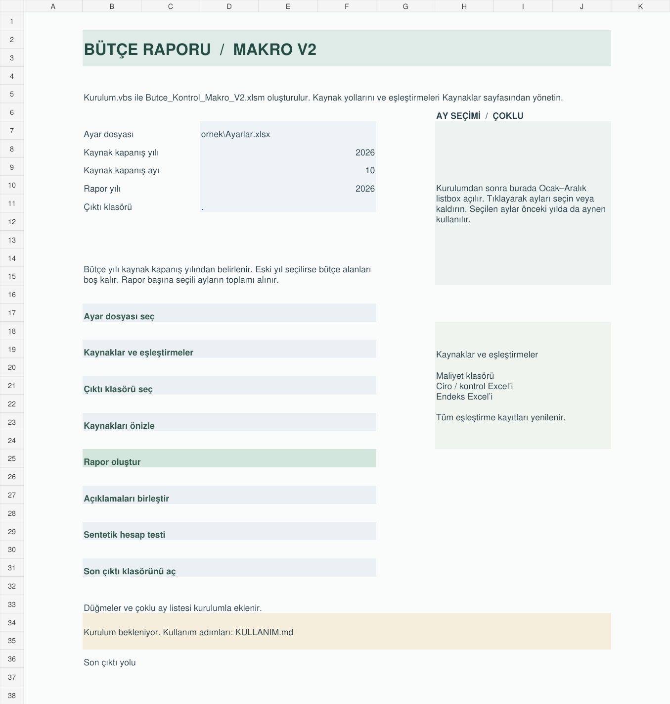

# Bütçe Sapması Analizi ve Aylık Kapanış Raporlama Otomasyonu

**Excel kaynaklarından bütçe sapması, maliyet ve aylık kapanış analizi**

Uygulama, farklı dosyalardaki bölüm giderlerini tek bir kapanışta toplar. Gerçekleşenleri bütçe ve önceki yılın aynı aylarıyla karşılaştırır, kaynak dip toplamlarını kontrol eder ve geçmiş aylarda sonradan değişen kalemleri gösterir. Direktörlük ve müdürlük raporları üretir.

## Çalıştırma seçenekleri

| Sürüm | Çıktı | İlk adım |
| --- | --- | --- |
| Excel VBA | Excel kontrol paneli, direktörlük ve müdürlük raporları | [Windows Excel kurulumu](docs/BASLANGIC.md#excel-vba) |
| Python | Yedi sayfalık yerel dashboard ve Excel raporları | [Python kurulumu](docs/BASLANGIC.md#python) |

Her iki sürümde kaynak yolları, bölüm ve gider eşleştirmeleri Excel'deki ayar dosyasından yönetilir. Python arayüzü tarayıcıda kendi bilgisayarınızda açılır. VBA paketi masaüstü Excel'de rapor üretir.

## Uygulama akışı

1. Maliyet dosyalarının bulunduğu klasörü, ciro/dip toplam kontrol dosyasını ve endeks dosyasını tanımlayın.
2. Kapanış dönemini ve rapor aylarını seçin. Örneğin Ocak, Mart ve Mayıs seçildiğinde, önceki yıl da yalnız aynı üç ayla hesaplanır.
3. Kaynak önizlemesinde bölüm eşleştirmelerini ve dönemleri kontrol edin. Dip toplam farklarını ve önceki kapanıştan gelen revizyonları inceleyin.
4. Raporları seçtiğiniz klasöre üretin. Önceki dönemden gelen açıklamaları topluca inceleyip düzenleyin veya onaylayın.

## Neleri gösterir?

- **Bütçe sapması ve gider yapısı** — Gerçekleşen, bütçe, bütçe eksi gerçekleşen, yüzde sapma ve ana/alt gider kırılımı.
- **Operasyon göstergeleri** — Kaynaktaki başlıklarıyla personel ve işlem adetleri. Bu adet satırları gider toplamının dışında tutulur.
- **Birim maliyet ve OPEX/ciro** — Endekslenmiş önceki yıl birim maliyeti, gider ağırlıklı reel iyileşme ve şirket cirosu üzerinden OPEX oranı.
- **Kapanış kontrolleri** — Bölüm dip toplamı mutabakatı, geçmiş ay gider/bütçe değişiklikleri ve eksik eşleştirme uyarıları.
- **Açıklama takibi** — Önceki dönem metinlerini inceleme kuyruğuna alma, toplu onay ve müdürlük metinlerini bölüm adlarıyla genel raporda birleştirme.

Python dashboard sayfaları Genel Durum, Personel, İşlem Adedi, Detay Durum, Bölüm Analizi, Birim Maliyet ve Sapma Öncelikleri. Altı ortak seçim müdürlük, müdürlük altı, lokasyon, bölüm, yıl ve ay kapsamını sayfalar arasında taşır.

## Sentetik demo

Örnek set tek direktörlük, dört müdürlük ve 12 bölüm içerir. Eylül ve Ekim 2026 kapanışlarının her birinde beş maliyet dosyası bulunur. Ekim kapanışı ve Ocak–Ekim seçimiyle beklenen gerçekleşen **3.449,38 milyon TL**, bütçe **3.440,94 milyon TL**, fark **−8,44 milyon TL**. Rapor akışı bir direktörlük geneli ve dört müdürlük dosyası üretir. [Başlangıç ve beklenen sonuçlar](docs/BASLANGIC.md)

Excel kontrol paneli önizlemesi

Görsel, kontrol paneli tasarım önizlemesidir.

## Doğrulama durumu

- Python'un paket içindeki **77 otomatik testi** bu paket hazırlanırken yeniden çalıştırıldı.
- V4'te kaydedilen **72 JavaScript/API kontrolü**, arayüzün çizim ve olay mantığının benzetimini ve canlı yerel API'yi kapsar. Gerçek tarayıcı yerleşimi ve Windows dosya diyalogları canlı kabul adımıdır.
- Excel VBA için kaynak, modül ve dağıtım paketi kontrolleri yapıldı. Windows Excel'de derleme ve rapor üretimi canlı kabul adımıdır.

[Hesap ve veri akışı](docs/VERI_VE_HESAP.md) · [Doğrulama ve canlı kontrol](docs/DOGRULAMA.md) · [Sürüm notları](docs/SURUM_NOTLARI.md)

Depodaki çalışma kitapları sentetik örnekler ve şablonlardır. Gerçek kaynakları, ayar kopyalarını, raporları, günlükleri ve yerel kayıtları kendi bilgisayarınızda veya kurumunuzun onaylı depolama alanında tutun.
